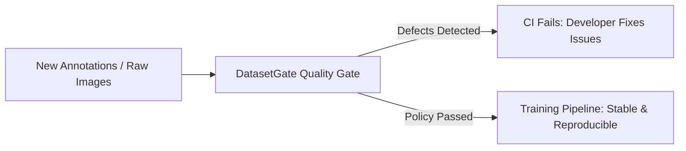
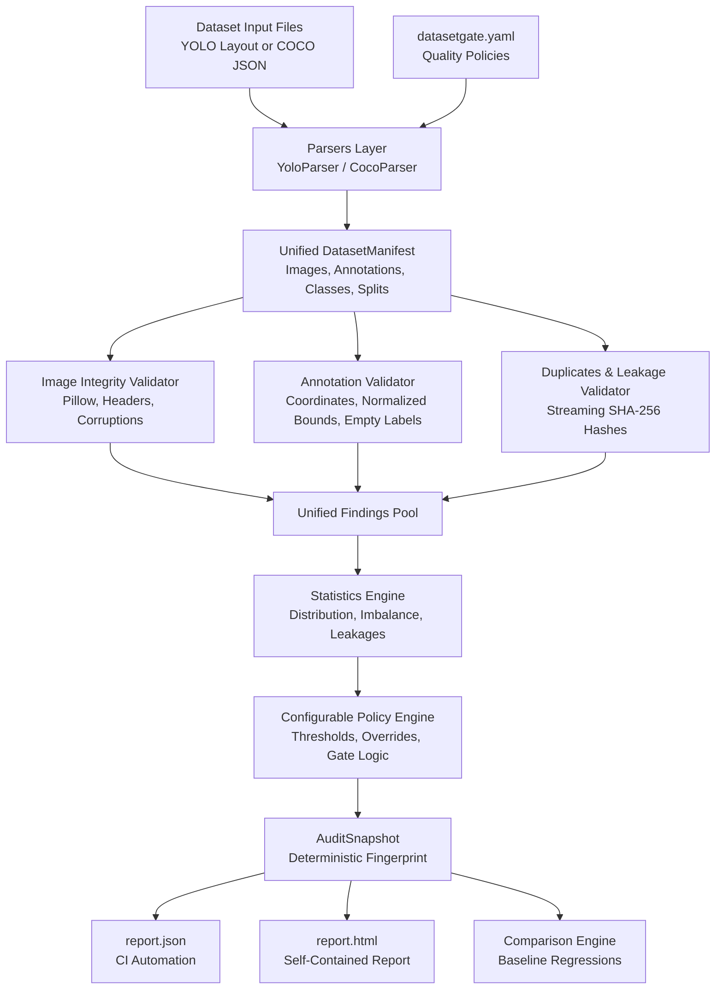

# DatasetGate

<p align="center">
  <strong>Don't train on a dataset you haven't verified.</strong>
</p>

<p align="center">
  <em>Local-first computer-vision dataset validation, defect auditing, and CI release-gating.</em>
</p>

<p align="center">
  
  
  
  
</p>

---

## 1. What is DatasetGate?

**DatasetGate** is a local-first, developer-focused dataset validation and release-gating tool for computer vision engineers. 

Before committing compute resources to training a model, DatasetGate inspects your dataset to identify structural corruptions, annotation errors, and cross-split data leakage, enforcing your team's quality policies directly on your local machine and in your CI/CD pipelines.

---

## 2. The Problem It Solves

Computer vision training runs are expensive, time-consuming, and notoriously brittle when faced with silent dataset defects.

Common silent defects include:
- **DataLoader crashes**: Corrupted, zero-byte, or unreadable image files crash multi-GPU training jobs hours into training.
- **Inflated validation metrics**: Identical images leaked across `train` and `val` splits create artificially high mAP scores that collapse in production.
- **Negative loss spikes**: Bounding boxes with negative coordinates or extending outside image boundaries destabilize loss calculations.
- **Silent dropouts**: Missing classes in train splits cause models to silently fail to predict rare objects.
- **Invisible regressions**: Annotation updates inadvertently introduce new formatting defects or worsen class imbalance.

DatasetGate catches these issues **before** training begins.

---

## 3. Why Training Pipelines Need Quality Gates

In software engineering, nobody merges code without unit tests, linting, and CI gates. Yet in machine learning, engineers frequently train on newly annotated or merged datasets without running equivalent quality checks.



DatasetGate brings software engineering rigor to dataset releases:
1. **Automated audits** in your CI pipeline.
2. **Deterministic baselines** to prevent regressions across dataset versions.
3. **Reproducible machine-readable (`report.json`) and human-readable (`report.html`) reports**.

---

## 4. Key Features

- **Local-First & Private**: Audits datasets 100% locally on your machine. No accounts, no cloud dependencies, and zero data uploads.
- **Format Support**: Ingests both YOLO and COCO object-detection datasets with automatic layout discovery.
- **Image Integrity Verification**: Uses Pillow to decode headers, verify byte integrity, and detect zero-byte or unreadable files.
- **Annotation Boundary & Syntax Checking**: Detects malformed rows, non-finite values (NaN / Inf), negative dimensions, and bounding boxes extending outside image boundaries.
- **Cross-Split Data Leakage Detection**: Uses streaming SHA-256 hashes to catch exact duplicate images present across `train`, `val`, and `test` splits.
- **Configurable Quality Policy Engine**: Custom YAML policy with user-defined thresholds, split requirements, and per-rule severity overrides.
- **Baseline Comparison & Regression Tracking**: Compare new dataset versions against a previous baseline snapshot to catch newly introduced defects.
- **Actionable Reporting**: Generates interactive, self-contained HTML reports (works offline without external CDNs) and structured JSON reports.
- **Developer-Friendly CLI**: Polished terminal interface powered by Rich, machine-readable exit codes (0, 1, 2, 3), and an instant synthetic demo mode.

---

## 5. Supported Formats

### YOLO
Supports standard Ultralytics layouts and custom configurations:
- Directory structure: `images/{train,val,test}` and `labels/{train,val,test}`
- Nested structure: `train/{images,labels}`, `val/{images,labels}`
- YAML specification: `data.yaml` or `dataset.yaml` with custom split paths and class names.
- Explicit negative samples: Cleanly distinguishes between empty label files (valid negatives) and missing label files.

### COCO
Supports COCO object-detection JSON files:
- Collections: `images`, `annotations`, `categories`.
- Reference integrity: Verifies that all `image_id` and `category_id` references exist.
- Bounding box syntax: Validates 4-element `[x, y, width, height]` arrays and checks against physical image dimensions.

---

## 6. Installation

Requires Python 3.11+.

> [!NOTE]
> DatasetGate is currently distributed directly via its public GitHub repository ahead of public PyPI release.

### Install from GitHub

Install the release directly using `pip`:

```bash
pip install "git+https://github.com/Satvik-jain/datasetgate.git@v0.1.2"
```

Or install the latest development version from `main`:

```bash
pip install "git+https://github.com/Satvik-jain/datasetgate.git"
```

### Install for Local Development

Clone the repository and install in editable mode with development dependencies:

```bash
git clone https://github.com/Satvik-jain/datasetgate.git
cd datasetgate
pip install -e ".[dev]"
```

---

## 7. Quick Start

### Try the Built-In Demo
You can try DatasetGate immediately without downloading external datasets:

```bash
datasetgate demo
```

This generates a synthetic dataset containing both valid images and deliberate defect samples (cross-split leakage, corrupted images, out-of-bounds boxes), runs an audit, and generates reports in `demo_dataset/reports/`.

### Initialize Your Project
Generate a recommended `datasetgate.yaml` configuration file:

```bash
datasetgate init
```

### Audit Your Dataset
```bash
# Standard audit
datasetgate audit ./my_dataset

# Audit with custom config and output directory
datasetgate audit ./my_dataset --config datasetgate.yaml --output reports/latest
```

---

## 8. CLI Usage Reference

```
Usage: datasetgate [OPTIONS] COMMAND [ARGS]...

Commands:
  init      Initialize a new datasetgate.yaml configuration file.
  audit     Audit a dataset for integrity, annotation, and leakage defects.
  snapshot  Generate a baseline snapshot JSON file for future regression tracking.
  compare   Compare two audit report JSON files to detect regressions.
  demo      Generate a synthetic demo dataset and run an immediate demonstration audit.
  version   Print the DatasetGate version.
```

### Audit Options

```bash
datasetgate audit <dataset_path> [OPTIONS]

Options:
  -c, --config PATH       Path to custom datasetgate.yaml configuration file.
  -o, --output PATH       Directory where report.json and report.html will be saved.
  -b, --baseline PATH     Path to previous audit report.json to check for regressions.
  --format TEXT           Explicit dataset format: 'auto', 'yolo', or 'coco'.
  -q, --quiet             Suppress standard terminal output.
  --help                  Show help message.
```

### Exit Codes

| Exit Code | Meaning |
|---|---|
| `0` | **Passed**: Dataset meets all configured quality policies. |
| `1` | **Failed**: Quality gate failed due to policy violations or regressions. |
| `2` | **Invalid Usage**: Incorrect CLI arguments or invalid configuration file. |
| `3` | **Runtime Error**: Unexpected execution error. |

---

## 9. Configuration

Customize dataset quality policies in `datasetgate.yaml`:

```yaml
version: 1

dataset:
  format: auto
  image_extensions:
    - .jpg
    - .jpeg
    - .png
    - .bmp
    - .webp

policy:
  # Class coverage requirements
  require_all_classes_in_train: true
  require_all_classes_in_val: false

  # Label distribution rules
  allow_unlabeled_images: true
  max_empty_label_rate: 0.20
  max_class_imbalance_ratio: 25.0

  # Leakage and duplicates: 'ignore', 'warn', 'fail'
  duplicate_policy: warn
  split_leakage_policy: fail

  # Physical integrity rules: 'ignore', 'warn', 'fail'
  corrupted_image_policy: fail
  missing_image_policy: fail
  out_of_bounds_policy: fail

  # Overall gate failure trigger
  fail_on:
    - error

  # Optional rule severity overrides:
  rule_severities:
    BBOX_OUT_OF_BOUNDS: warning

reporting:
  output_dir: reports
  generate_html: true
  generate_json: true
```

See [docs/CONFIGURATION.md](docs/CONFIGURATION.md) for full configuration details.

---

## 10. Example Terminal & HTML Outputs

### Terminal Output
DatasetGate outputs a clean, structured summary in the terminal:

```
┌───────────────────────────── DatasetGate Audit: demo (YOLO) ──────────────────────────────┐
│ Metric                 │ Value                                                            │
├────────────────────────┼──────────────────────────────────────────────────────────────────┤
│ Total Images           │ 8                                                                │
│ Total Annotations      │ 8                                                                │
│ Dataset Splits         │ train (6), val (2)                                               │
│ Classes Count          │ 2                                                                │
│ Empty Label Rate       │ 12.5%                                                            │
│ Class Imbalance Ratio  │ 1.7:1                                                            │
│ Duplicate Image Groups │ 0                                                                │
│ Cross-Split Leakages   │ 1                                                                │
│ Fingerprint            │ 2d92ffe4660915b19938fc259472081058eaaa83a01b184c9dbcbff6ff182564 │
└────────────────────────┴──────────────────────────────────────────────────────────────────┘

Errors (5):
  • BBOX_OUT_OF_BOUNDS: Bounding box [0.750, 0.350, 1.150, 0.650] extends outside normalized image bounds at labels/train/train_oob.txt:1.
  • CORRUPTED_IMAGE: Corrupted or unreadable image file 'images/train/train_corrupted.jpg'.
  • SPLIT_LEAKAGE: Exact duplicate image leaked across splits (train, val). Found in split 'train', duplicates: images/val/val_leaked.jpg.
  • SPLIT_LEAKAGE: Exact duplicate image leaked across splits (train, val). Found in split 'val', duplicates: images/train/train_leaked.jpg.
  • MISSING_CLASS_IN_TRAIN: Train split is missing annotations for 1 declared class(es): traffic_sign.

╭─────────────────────────────────── QUALITY GATE FAILED ───────────────────────────────────╮
│ Violations detected against configured policy.                                            │
│ Inspect reports: reports/report.json and reports/report.html                              │
╰───────────────────────────────────────────────────────────────────────────────────────────╯
```

### Self-Contained HTML Report
Every audit generates a self-contained, responsive HTML report (`report.html`) containing:
- Executive summary and overall policy status.
- Key metrics grid (images, annotations, empty label rate, class imbalance).
- Per-split distribution breakdown.
- Class distribution visual percentage bars.
- Interactive findings table with live severity filtering.
- Actionable, tailored remediation recommendations.

---

## 11. Baseline Comparison & Regression Detection

Prevent quality regressions across dataset releases by comparing audits against a baseline:

```bash
# 1. Audit initial dataset version and save as baseline
datasetgate snapshot ./dataset_v1 --output baselines/v1.json

# 2. Audit updated dataset version against baseline
datasetgate audit ./dataset_v2 --baseline baselines/v1.json

# 3. Or compare two reports directly
datasetgate compare baselines/v1.json reports/v2/report.json
```

DatasetGate detects:
- Newly introduced errors.
- Resolved errors.
- Cross-split leakage increases.
- Classes that dropped out of the training split.
- Significant class imbalance increases.

---

## 12. GitHub Actions Integration

Automate dataset validation on every Pull Request modifying your dataset.

Example workflow file (`examples/github-actions/datasetgate.yml`):

```yaml
name: Dataset Quality Gate

on:
  pull_request:
    paths:
      - 'dataset/**'
      - 'datasetgate.yaml'

jobs:
  validate:
    runs-on: ubuntu-latest
    steps:
      - uses: actions/checkout@v4
      - uses: actions/setup-python@v5
        with:
          python-version: "3.11"
      - run: pip install "git+https://github.com/Satvik-jain/datasetgate.git@v0.1.2"
      - run: datasetgate audit ./dataset --config datasetgate.yaml --output reports
      - uses: actions/upload-artifact@v4
        if: always()
        with:
          name: datasetgate-report
          path: reports/
```

---

## 13. System Architecture



See [docs/ARCHITECTURE.md](docs/ARCHITECTURE.md) for full architectural documentation.

---

## 14. Current Limitations

- **Object Detection Only**: v0.1 supports object detection bounding boxes (YOLO and COCO). Segmentation masks and keypoints are planned for v0.3.
- **Exact Duplicates Only**: v0.1 detects exact byte-for-byte duplicates using SHA-256 hashes. Perceptual hashing (pHash) for resized/re-compressed images is planned for v0.2.
- **Local Processing**: Processes datasets locally on a single machine; distributed processing for petabyte-scale datasets is on the v1.0 roadmap.

---

## 15. Roadmap

- **v0.2.0**: Pascal VOC XML format, automated CLI fixes (`datasetgate fix --clip-boxes`), and perceptual duplicate detection.
- **v0.3.0**: Polygon segmentation masks, keypoints/pose detection, and small-object detection analytics.
- **v1.0.0**: Team dataset registry server and training performance correlation.

See [docs/ROADMAP.md](docs/ROADMAP.md) for detailed release plans.

---

## 16. Contributing

Contributions are warmly welcomed! Please follow these guidelines:

1. Fork the repository and create a feature branch (`git checkout -b feat/my-feature`).
2. Install development dependencies:
   ```bash
   pip install -e ".[dev]"
   ```
3. Run tests and linting:
   ```bash
   pytest
   ruff check .
   ruff format --check .
   ```
4. Commit using [Conventional Commits](https://www.conventionalcommits.org/) and submit a Pull Request.

---

## 17. License

DatasetGate is open source software licensed under the **Apache-2.0 License**. See [LICENSE](LICENSE) for details.
