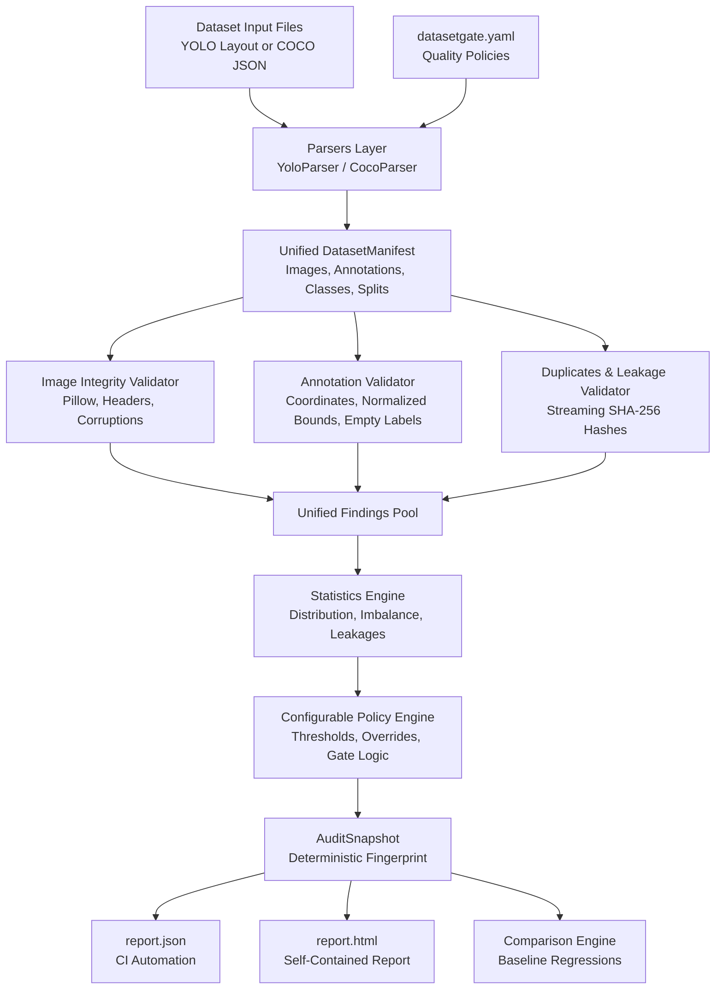
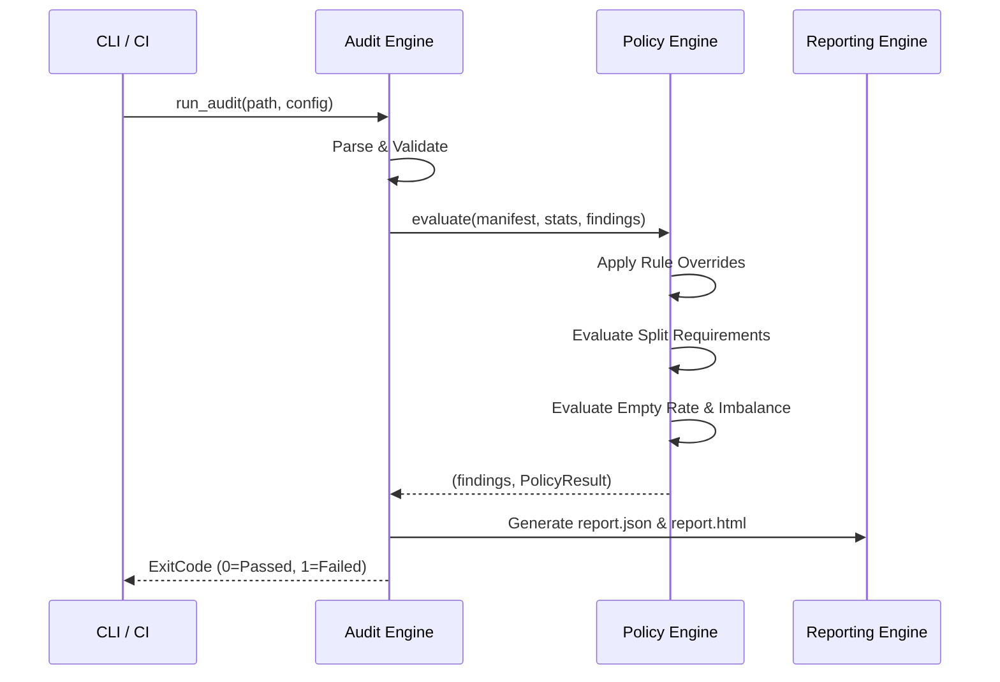

# DatasetGate Architecture & Design

DatasetGate is designed as a local-first, modular, decoupled computer-vision dataset auditing and release-gating system.

## 1. High-Level System Architecture

## 2. Ingestion & Manifest Normalization

Datasets in computer vision often arrive in fragmented, idiosyncratic directory layouts. The Ingestion layer abstracts away file layouts into an internal, normalized `DatasetManifest`:

- **Decoupled Representation**: Regardless of whether a dataset originates from Ultralytics YOLO (`images/` and `labels/` pairs) or Microsoft COCO (top-level JSON mapping), the rest of the application interacts strictly with `ImageMetadata`, `BoundingBox`, and `ImageAnnotation`.
- **Zero In-Memory Duplication**: Image files are inspected streaming or lazily; image pixel arrays are never retained in RAM, keeping memory usage constant (~50MB) even on datasets with 100,000+ images.
- **Explicit Negative Sample Semantics**: Distinguishes empty annotation files (`has_label_file=True, is_empty_label=True`, a valid negative sample) from missing annotation files (`has_label_file=False`).

## 3. Validation Pipeline

DatasetGate executes independent, testable validators:

1. **`ImageIntegrityValidator`**:
   - Checks file existence and non-zero size.
   - Verifies allowed file extensions.
   - Decodes image headers using Pillow `verify()` and reads width/height.
   - Detects truncated, damaged, or unreadable files.

2. **`AnnotationValidator`**:
   - Verifies coordinate counts and numeric types (rejecting NaN, Inf, negative dimensions).
   - Validates normalized bounding box coordinates $[0, 1]$ in YOLO and absolute bounding boxes against image width/height in COCO.
   - Verifies category and image reference integrity.
   - Validates unlabeled image policies.

3. **`DuplicateValidator`**:
   - Streams file bytes into SHA-256 hashes in 64KB chunks.
   - Detects exact duplicate image groups.
   - Groups duplicates by split to detect **Cross-Split Data Leakage** (e.g. an identical image present in both `train` and `val`).

## 4. Statistics and Policy Evaluation

The Policy Engine checks thresholds configured in `datasetgate.yaml`:
- `require_all_classes_in_train`
- `require_all_classes_in_val`
- `max_empty_label_rate`
- `max_class_imbalance_ratio`
- `duplicate_policy` (`ignore`, `warn`, `fail`)
- `split_leakage_policy` (`ignore`, `warn`, `fail`)
- `fail_on`: List of severities (`error`, `warning`) that trigger exit code 1.

## 5. Baseline Comparison & Regression Detection

DatasetGate computes a deterministic 16-character SHA-256 fingerprint from:
- Sorted relative image paths and hashes.
- Declared class names and IDs.
- Total image and annotation counts.

When comparing a current audit against a baseline `report.json`:
- It detects newly introduced errors.
- It detects resolved errors.
- It identifies regressions:
  - New errors introduced into the dataset.
  - New cross-split data leakages.
  - Overall policy status regression (e.g. baseline passed, current failed).
  - Classes no longer represented in the train split.
  - Significant worsening of class imbalance.

## 6. Exit Codes

- `0`: Quality gate passed. Dataset meets all configured policies.
- `1`: Quality gate failed. Policy violations or regressions detected.
- `2`: Bad invocation or invalid configuration.
- `3`: Unexpected runtime or execution error.
